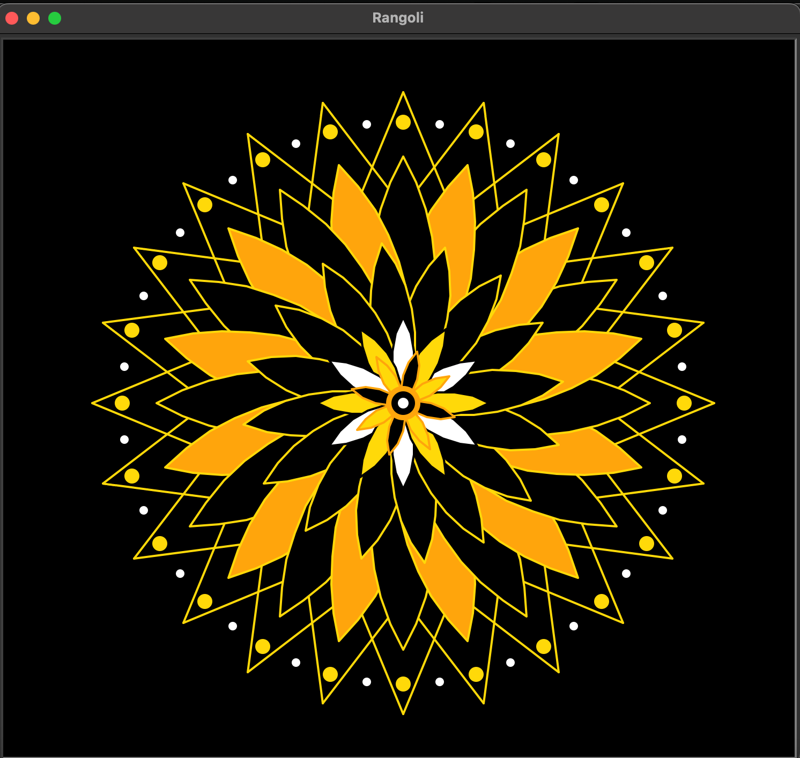

# COMP115 Project 1: Python Turtle Drawing

## Description
I started off with a completely project in mind and then pivoted to this one. I used my python turtle to draw a rangoli. Rangoli is a decorative pattern drawn on floor by hand using colourful materials. The design is intricate and involves repetitive geometrical shapes and radial symmetry; so I used python loops for automation and utilized the "range()" function within nested loops to repeatedly rotate the turtle and scale the shapes, allowing the code to generate complex, mirroring layers efficiently. Another reason for choosing this design is that hand made rangoli is often made with stencils which can be generated using python codes like these. 

## How to Run the Code
1. Make sure you have Python installed.
2. Run the script using your IDE (like IDLE, VS Code) or by running:
   ```bash
   rangoli final code.py
   ```

## Final Drawing Screenshot


